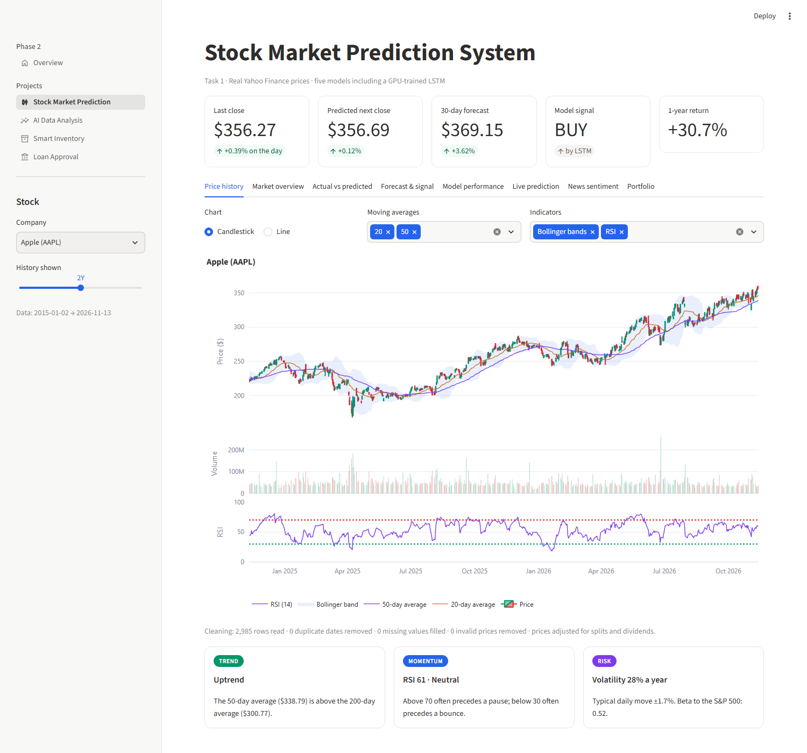
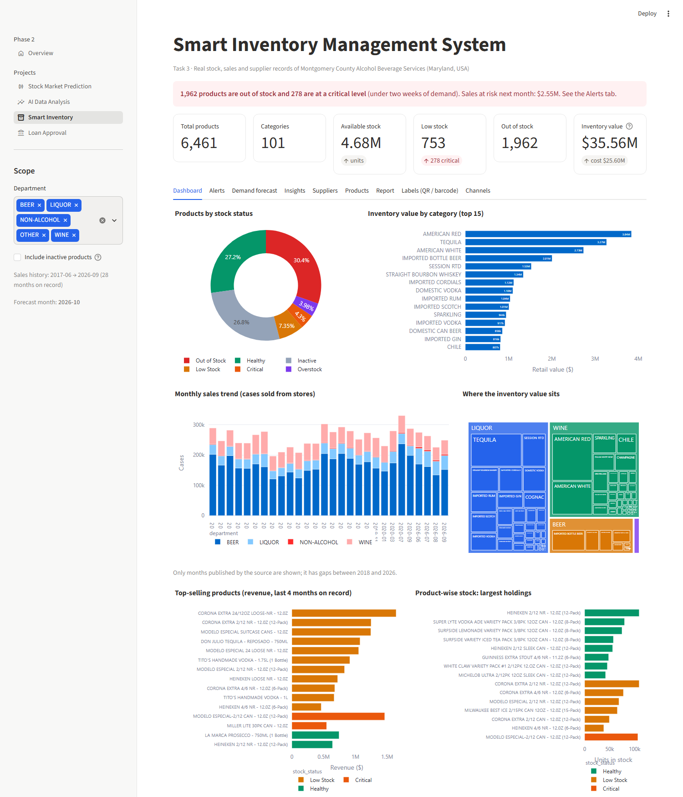
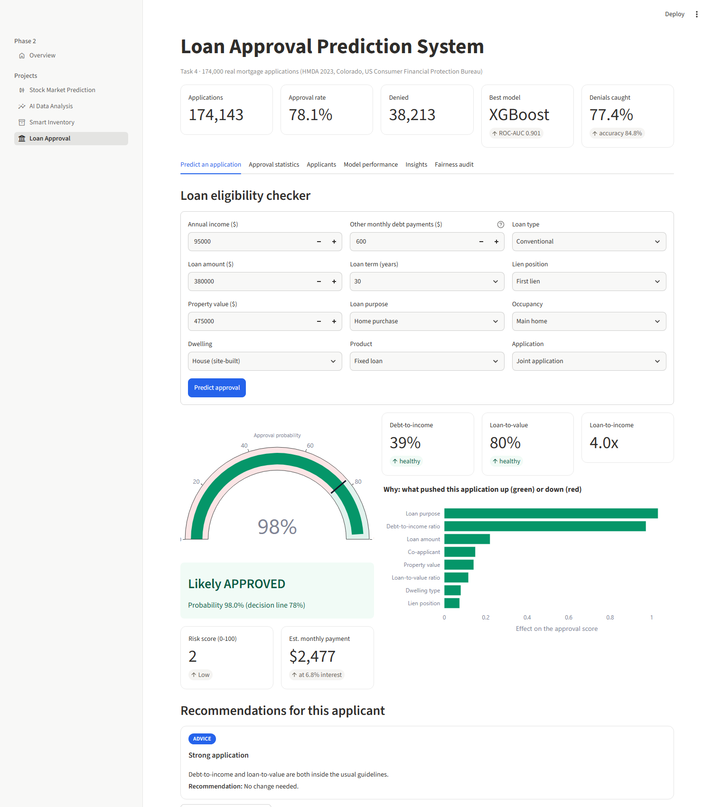
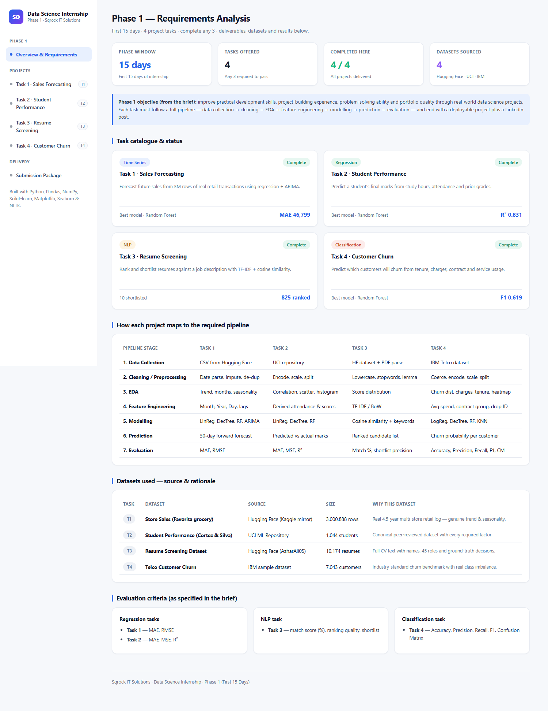

# Sqrock IT Solutions · Data Science Internship


Eight end-to-end data science projects completed during my internship at **Sqrock IT Solutions**,
built on **real, public datasets** rather than generated data. Each project covers the full workflow:
data collection, cleaning, exploratory analysis, modelling, honest evaluation and a dashboard.

| Phase | Projects | Dashboard |
|---|---|---|
| [**Phase 1**](phase1_data_science/) | Sales forecasting · Student performance · Resume screening · Customer churn | Static web dashboard ([live demo](https://equityaviator.github.io/Sqrock-IT-Solutions-Data-Science-Intern-/)) |
| [**Phase 2**](phase2_data_science/) | Stock market prediction · AI data analysis dashboard · Smart inventory · Loan approval | Streamlit app (`streamlit run app.py`) |

---

## Phase 2



| # | Project | Real dataset | Best model | Result on unseen data |
|---|---|---|---|---|
| 1 | [Stock Market Prediction](phase2_data_science/task1_stock_prediction/) | Yahoo Finance: 10 US stocks + S&P 500, 2015 – Nov 2026 | LSTM and XGBoost (GPU) | R² **0.988**, price error **1.5%**; direction right **53%** |
| 2 | [AI Data Analysis Dashboard](phase2_data_science/task2_ai_dashboard/) | Any CSV / Excel / JSON upload | Statistical tests + Isolation Forest | Ranked insights with recommendations, PDF / HTML report |
| 3 | [Smart Inventory Management](phase2_data_science/task3_inventory/) | Montgomery County (USA) ABS: 7,020 products, 305 suppliers | Moving average | Forecast error **21%**; $2.5M monthly sales at risk flagged |
| 4 | [Loan Approval Prediction](phase2_data_science/task4_loan_approval/) | US HMDA 2023: **174,143** mortgage applications | XGBoost (GPU) | ROC-AUC **0.90**, accuracy **84.8%**, **77%** of denials caught |

**Also included:** candlestick charts and technical indicators, 30-day forecasts, buy/sell signal with backtest,
live prices, news sentiment, portfolio analysis, QR code and barcode labels, restocking list, supplier
performance, explainable predictions (SHAP), a fairness audit, PDF and Excel export, and a login screen.

| Smart inventory | Loan approval |
|---|---|
|  |  |

Full write-up: [Phase 2 report](phase2_data_science/reports/Phase2_Report.md)

## Phase 1



| # | Project | Real dataset | Best model | Result |
|---|---|---|---|---|
| 1 | [Sales Forecasting](phase1_data_science/task1_sales_forecasting/) | Favorita store sales, 3,000,888 rows | Random Forest | MAE 46,799 · RMSE 64,171 (ARIMA: 148,933) |
| 2 | [Student Performance](phase1_data_science/task2_student_performance/) | UCI Student Performance, 1,044 students | Random Forest | R² **0.831** · MAE 0.90 (marks out of 20) |
| 3 | [AI Resume Screening](phase1_data_science/task3_resume_screening/) | 825 real data-scientist resumes | TF-IDF + cosine similarity + skill matching | 825 ranked, top 10 shortlisted |
| 4 | [Customer Churn](phase1_data_science/task4_churn_prediction/) | IBM Telco, 7,043 customers | Random Forest | F1 **0.619** · ROC-AUC **0.835** |

Full write-up: [Phase 1 report](phase1_data_science/reports/Phase1_Report.md)

---

## Quick start

```bash
git clone https://github.com/EquityAviator/Sqrock-IT-Solutions-Data-Science-Intern-.git
cd Sqrock-IT-Solutions-Data-Science-Intern-
```

**Phase 2** (data and trained models are included, so the dashboard runs straight away):

```bash
cd phase2_data_science
pip install -r requirements.txt
streamlit run app.py
```

**Phase 1** (large datasets are downloaded by a script, not stored in the repository):

```bash
cd phase1_data_science
pip install -r requirements.txt
python download_data.py
python task1_sales_forecasting/sales_forecasting.py     # likewise for tasks 2-4
# then open web/index.html
```

Retraining the Phase 2 models, the GPU setup, tests and the run logger are described in the
[Phase 2 README](phase2_data_science/README.md).

## How the work was done

- **Real data only.** Sources and download dates are recorded in
  [`phase2_data_science/data/SOURCES.json`](phase2_data_science/data/SOURCES.json) and the Phase 1 report.
- **No data leakage.** Time-ordered splits for time series, preprocessing fitted on training data only,
  models chosen on a validation set, test set used once.
- **Honest baselines.** Every forecast is compared with a naive baseline, and the reports say so when a
  model does not beat it (the stock models match "tomorrow = today"; a moving average beats ML on inventory).
- **Fair lending.** Sex, age, race and ethnicity are never model inputs in the loan project; they are used
  only to audit the finished model.
- **Tested.** Phase 2 ships 16 functional checks: `python tests/test_features.py`.

## Tech stack

Python · Pandas · NumPy · Scikit-learn · XGBoost · PyTorch · Statsmodels · NLTK · Plotly · Matplotlib ·
Seaborn · Streamlit · Chart.js

## Repository layout

```
phase1_data_science/     4 projects, static dashboard (web/), notebooks, report
phase2_data_science/     4 projects, Streamlit app (app.py, ui/), notebooks, tests, report
index.html               redirects GitHub Pages to the Phase 1 dashboard
```

## Disclaimer

The stock forecasts and loan predictions are learning projects. They are not financial advice and
must not be used for real trading or lending decisions.

## License

[MIT](LICENSE). Datasets belong to their original publishers and are used under their open-data terms.
